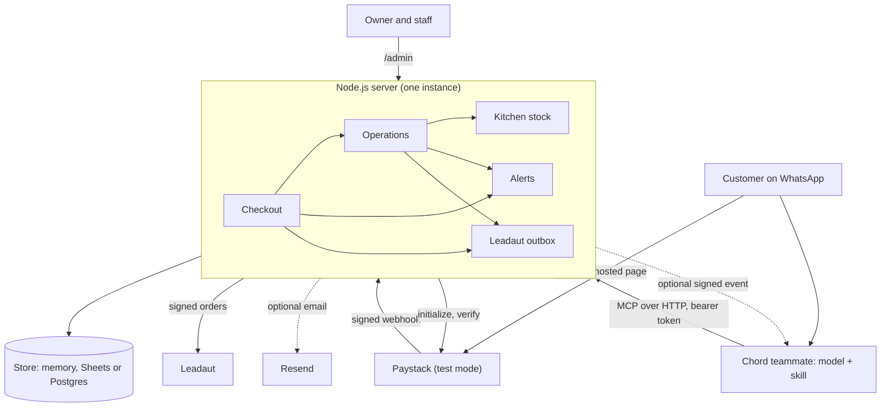
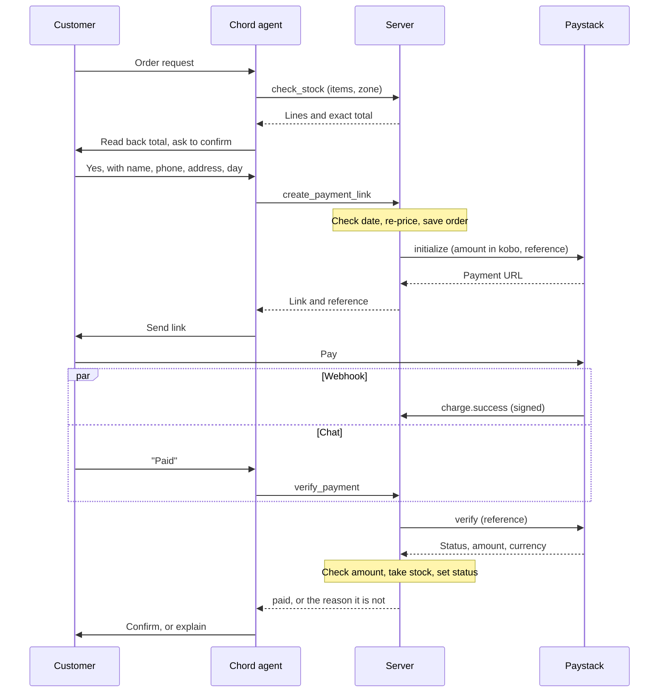
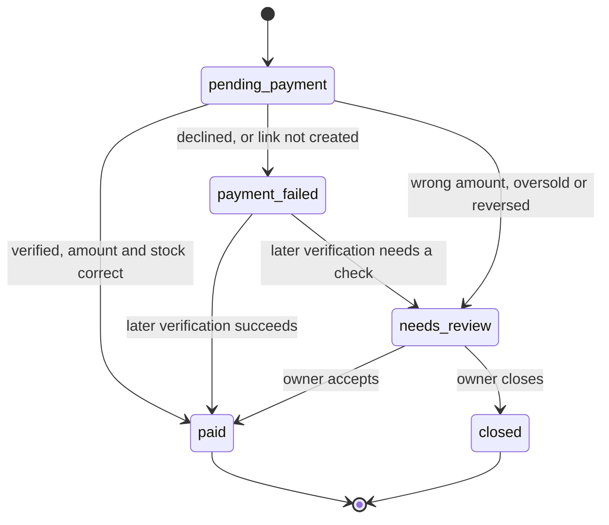
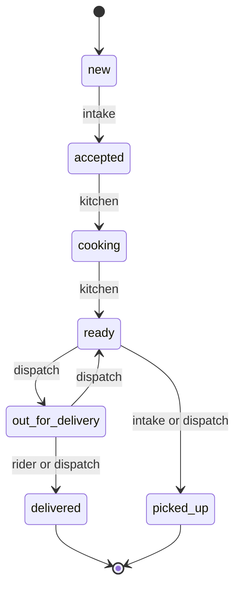

# Technical Requirements Document: WhatsApp Checkout Agent

**Product:** Mama Tola's Kitchen, a WhatsApp checkout teammate on Chord, with a kitchen back office

| | |
| --- | --- |
| Version | 1.1 (defect status updated) |
| Date | 25 November 2026 |
| Author | Okewale Olumide |
| Baseline | Commit `b5d203f` on `main` (30 October 2026, as submitted) |
| Audience | Engineers and reviewers assessing the build or taking it to production |
| Context | TSG Labs build exercise. The business is made up, all data is fake, and only Paystack test keys are used. |

This document was written after the build. Sections 1 to 12 describe what exists at the baseline commit. Section 13 lists the defects found at the baseline and whether each is fixed. Sections 14 to 17 cover the proposed rollout, which has not been approved; section 14 shows which engineering work is already done.

**Version 1.1:** the fixes are on branch `fix/trd-d01-d13`, not yet merged to `main`. Only defect statuses have been updated: section 13, and the rows elsewhere that cite a defect. The rest of sections 1 to 12 still describes the baseline.

## 1. Summary

Small food vendors in Lagos sell party trays on WhatsApp. They take orders by chat, wait for transfer screenshots, and check bank alerts by hand. That costs evenings and exposes them to fake receipts.

This system takes the order in chat, quotes the exact total from a live menu, sends a Paystack payment link, and confirms the order only after Paystack verifies the payment. Paid orders then move through a staff portal, and each one can be synced to Leadaut, the revenue system.

**Design principle:** the language model handles conversation; the server owns prices, stock and payment status. A model mistake can produce a wrong sentence. It cannot set a price or mark an order as paid.

**Status at baseline**

| Area | Status |
| --- | --- |
| WhatsApp checkout with verified payment | Built. Run end to end in the Chord WhatsApp simulator with a Paystack test payment on 29 October (field notes). |
| Back office, alerts, stock, expenses, pay | Built and covered by automated tests. Not used by real staff. |
| Leadaut sync | Built. Payload format checked against Leadaut's parser (`docs/leadaut-sync.md`). |
| Automated tests | 110 of 110 pass, including 7 against Postgres 16 (run 25 November 2026). |
| Live server | Responding on Render's free plan with the in-memory store (checked 25 November 2026). |
| Production use | Not ready. See sections 13 and 14. |

## 2. Goals and scope

### 2.1 Goals

| ID | Goal |
| --- | --- |
| G1 | A customer can go from "hello" to a confirmed, paid order without the owner stepping in. |
| G2 | No order is confirmed without verified payment of the exact amount. |
| G3 | Every problem payment reaches a person, with the reason. |
| G4 | Staff can see and move paid orders through to delivery or pickup. |
| G5 | Confirmed orders reach the revenue system reliably, without double counting. |

### 2.2 In scope at baseline

- Ordering, quoting, payment link, payment verification and order status over WhatsApp, through Chord.
- Staff portal: order queue, held payments, rota, staff, stock, expenses, pay and integrations.
- Alerts in the portal, and optional alerts by email.
- Leadaut sync and optional signed events to Chord.

### 2.3 Out of scope at baseline

Automated refunds, same-day orders, multiple currencies, live rider tracking, and messages sent to customers first. The skill also declines catering staff, cake orders, live cooking and delivery outside Lagos.

### 2.4 Users

| User | Uses | Needs |
| --- | --- | --- |
| Customer | WhatsApp, Paystack page | Accurate quote, quick link, honest payment status |
| Owner (Tola) | Portal, Chord dashboard | Verified money, control of exceptions, rota and costs |
| Intake | Portal | New paid orders and held-payment alerts |
| Kitchen | Portal | What to cook and by when, stock counts |
| Dispatch | Portal | Ready orders, choice of rider |
| Rider | Portal | Address, customer number, mark delivered |

## 3. Architecture



### 3.1 Components

| Component | Source | Responsibility |
| --- | --- | --- |
| Skill | `skills/mama-tolas-kitchen/` | Tone, conversation flow, hard rules, when to pass to the owner |
| MCP tools | `src/mcp.ts` | Four tools with validated input |
| Checkout | `src/checkout.ts`, `src/domain.ts` | Quotes, links, verification, held payments |
| Paystack client | `src/paystack.ts` | Timeouts, retries, error classes, test-key guard |
| HTTP server | `src/server.ts`, `src/webhook.ts` | Routing, authentication, webhook signatures |
| Operations | `src/ops/operations.ts` | Order stages, permissions, assignment |
| Alerts | `src/ops/alerts.ts` | Live portal updates and email |
| Kitchen | `src/stock/kitchen.ts` | Ingredients, recipes, expenses, pay |
| Revenue | `src/revenue/` | Leadaut connection, order mapping, retrying outbox |
| Portal | `src/admin/` | Server-rendered pages, sign-in, forms |
| Stores | `src/store/` | One order-store interface with three implementations |

### 3.2 Technology

TypeScript on Node.js (20 or later; the container uses 22), Express 5, MCP SDK, Zod 3, `pg`, and `google-auth-library`. Tests use Vitest and Supertest. The portal is server-rendered HTML with no front-end framework. Deployment is a Docker image on Render, or Docker Compose with Caddy on a VPS.

## 4. Core flow: order to confirmed payment



The webhook and chat paths run the same `verifyPayment` function, queued per order. The webhook body is used only for the reference; amounts always come from Paystack's verify API.

### 4.1 Payment status



| Paystack result | Order status | What the customer is told |
| --- | --- | --- |
| Success, exact amount, in stock | `paid` | Confirmed |
| Success, wrong amount or currency | `needs_review` | Staff will check |
| Success, item sold out | `needs_review` | Apology; the owner will call with a swap or refund |
| Failed | `payment_failed` | The reason if clear, and an offer of a new link |
| Reversed | `needs_review` | Staff will handle it |
| Abandoned, pending, or not found | unchanged | Not paid yet; the link is resent |
| Paystack unreachable | unchanged | Cannot check yet; try again shortly |

### 4.2 Kitchen stages



The owner can make any move in the diagram. The owner alone can cancel, from `new`, `accepted`, `cooking` or `ready`.

## 5. Functional requirements

**Status:** *Built* is enforced in code. *Partial* is built with a gap listed in section 13. *Prompt only* relies on the skill's instructions. *Built (D-xx)* had a gap at the baseline, now fixed as listed in section 13.

### 5.1 Ordering and quoting

| ID | Requirement | Status |
| --- | --- | --- |
| FR-01 | Return the live menu, stock, delivery zones and today's Lagos date. | Built |
| FR-02 | Compute line totals, delivery fee and order total on the server. | Built |
| FR-03 | Reject unknown items, sold-out items and unknown zones, reporting all problems together. | Built |
| FR-04 | Merge repeated items before checking stock. | Built |
| FR-05 | Quantity per line is a whole number from 1 to 50. | Built |
| FR-06 | Orders must be for tomorrow or later, by Lagos date. | Built (D-09) |
| FR-07 | Orders above ₦300,000 go to the owner. | Built (D-09) |
| FR-08 | Delivery is between 10am and 6pm. | Prompt only |
| FR-09 | Call `check_stock` before stating any price. | Prompt only |

### 5.2 Payment

| ID | Requirement | Status |
| --- | --- | --- |
| FR-10 | Re-price when creating a link, and charge that total in kobo. | Built |
| FR-11 | Same phone, basket and zone, unpaid and under 30 minutes old, returns the same link. | Built (D-03, D-07) |
| FR-12 | Confirm only when Paystack reports success with the exact amount in NGN. | Built |
| FR-13 | Process each successful payment exactly once. | Built (D-01, D-10) |
| FR-14 | Hold wrong-amount, oversold and reversed payments for the owner. | Built |
| FR-15 | The owner can accept or close a held payment. Staff can only view it. | Built (D-05) |
| FR-16 | Never confirm when Paystack cannot be reached. | Built |
| FR-17 | Confirm from the webhook when the customer says nothing further. | Built (D-02) |
| FR-18 | Detect a reversal after an order is confirmed. | Built (D-11); not checked against real Paystack |

### 5.3 Kitchen operations

| ID | Requirement | Status |
| --- | --- | --- |
| FR-20 | Only paid orders enter the queue, sorted by the day needed. | Built |
| FR-21 | Enforce valid moves and roles on the server. | Built |
| FR-22 | On accept, assign the on-duty cook with the fewest open orders. | Built |
| FR-23 | On dispatch, assign a rider the same way unless dispatch picks one. | Built |
| FR-24 | A rider can close only their own delivery. | Built |
| FR-25 | Record every move with time, person and note. | Built |
| FR-26 | Alert the people an order needs next, never about their own move. | Built |
| FR-27 | `order_status` gives the stage, with rider details only while out for delivery. | Built |
| FR-28 | Offer a ready-written customer update that opens WhatsApp. | Built |
| FR-29 | The owner sets the weekly rota; unset days use the default. | Built |

### 5.4 Stock and money

| ID | Requirement | Status |
| --- | --- | --- |
| FR-30 | Take menu stock when payment is verified. | Built (D-04, D-05) |
| FR-31 | Take recipe ingredients once, when cooking starts. | Built |
| FR-32 | Warn when an ingredient is at or below its limit. | Built |
| FR-33 | Owner and kitchen staff can record a stock count. | Built |
| FR-34 | Ingredient purchases restock and update the unit price. | Built |
| FR-35 | Show ingredient cost and margin per menu item. | Built |
| FR-36 | Calculate monthly pay from the rota, per shift or fixed. | Built |
| FR-37 | The owner can edit menu prices, stock and zones. | Built (D-08) |

### 5.5 Revenue sync

| ID | Requirement | Status |
| --- | --- | --- |
| FR-40 | Send confirmed orders and their completion or cancellation to Leadaut. | Built (D-12) |
| FR-41 | Retry temporary failures with backoff; stop on permanent ones. | Built |
| FR-42 | Keep updates for one order in sequence. | Built (D-14) |
| FR-43 | Check the URL and secret before saving a connection. | Built |
| FR-44 | Keep undelivered events through a restart. | Built (Postgres only) |

## 6. Interfaces

### 6.1 HTTP endpoints

| Route | Authentication | Purpose |
| --- | --- | --- |
| `POST /mcp` | Bearer token | Agent tools. Stateless; a new server and transport per request. |
| `POST /webhooks/paystack` | HMAC-SHA512 of the raw body | Payment notification |
| `GET /healthz` | None | Store in use and Leadaut event counts |
| `/admin/*` | Signed session cookie | Portal. Returns 404 unless `ADMIN_PASSWORD` is set. |
| `GET /admin/live` | Signed session cookie | Server-Sent Events for live updates |

### 6.2 MCP tools

| Tool | Input | Output |
| --- | --- | --- |
| `check_stock` | `items?: [{sku, qty}]`, `delivery_zone?` | Menu and zones, or priced lines with `total_ngn`; `today` |
| `create_payment_link` | `customer_name`, `customer_phone`, `customer_email?`, `items`, `delivery_zone`, `delivery_address`, `needed_by?` | `reference`, `payment_url`, `total_ngn`, `reused?` |
| `verify_payment` | `reference` | `status`: `paid`, `not_paid_yet`, `payment_failed`, `needs_review` or `closed` |
| `order_status` | `reference` | `stage`, `stage_label`, `needed_by`, `rider?` |

Every result has `ok` and a plain-English `next_step`. Business failures are returned as normal results so the model reads the guidance. Unexpected errors return `internal_error` with an instruction not to confirm anything.

```json
{
  "ok": true,
  "reference": "MTK-261029-AB12C",
  "payment_url": "https://checkout.paystack.com/...",
  "total_ngn": 61000,
  "next_step": "Send the payment link and the reference. ..."
}
```

### 6.3 Paystack

| Property | Value |
| --- | --- |
| Calls | `POST /transaction/initialize`, `GET /transaction/verify/{reference}` |
| Timeout | 6 seconds per attempt |
| Retries | 2, after 300 ms and 600 ms, on 5xx, timeout or network error |
| Error classes | `provider_down`, `rejected`, `not_found` |
| Key guard | Startup fails unless the key begins `sk_test_` |
| Webhook event handled | `charge.success` only |

### 6.4 Leadaut

Orders are sent in WooCommerce order format to Leadaut's existing store webhook, so Leadaut needed no new code. Each body is signed with base64 HMAC-SHA256.

| Trigger | Topic | Status sent |
| --- | --- | --- |
| Payment confirmed | `order.created` | `processing` |
| Delivered | `order.updated` | `delivered` |
| Picked up | `order.updated` | `picked-up` |
| Cancelled | `order.refunded` | `refunded` |

Retries start at 30 seconds and double, capped at one hour, for up to 8 attempts. Leadaut can return HTTP 200 with `ok: false`, so the body is checked. `bad_signature`, `unknown_integration`, `invalid_json` and `account_missing` are not retried.

### 6.5 Chord events (optional)

`order.paid`, `order.needs_review` and `order.stage_changed` are signed with HMAC-SHA256 over `timestamp.body`. They cannot message the customer (see section 12). The stage event includes the customer's phone number.

## 7. Data

### 7.1 Order

| Field | Notes |
| --- | --- |
| `reference` | `MTK-YYMMDD-XXXXX`, unique, shared with Paystack |
| `customerName`, `customerPhone` | Phone normalised to `+234...`; supplied by the model |
| `lines[]` | SKU, name, quantity and unit price at order time |
| `deliveryZone`, `deliveryAddress` | Zone must match the list |
| `subtotalNgn`, `deliveryFeeNgn`, `totalNgn` | Whole naira, server-computed |
| `status`, `paymentUrl`, `paidAt`, `note` | Payment state and reason |
| `neededBy` | Lagos date, optional |

Kitchen progress is kept in a separate record (`OrderOps`: stage, cook, rider, history), so checkout and operations change independently.

### 7.2 Postgres tables

| Group | Tables |
| --- | --- |
| Selling | `orders`, `menu_items`, `delivery_zones` |
| Operations | `order_ops`, `staff`, `rota`, `rota_set` |
| Stock and money | `ingredients`, `recipes`, `stock_moves`, `expenses`, `pay_rates` |
| System | `revenue_outbox`, `settings` |

Most records are stored whole as JSONB beside the columns used for lookup, so adding an optional field needs no migration. Tables are created at startup under an advisory lock. Seed data fills empty tables only.

### 7.3 Store options

| `STORE` | Kept through a restart | If its settings are missing |
| --- | --- | --- |
| `memory` (default) | Nothing | Not applicable |
| `sheets` | Menu, stock, zones and orders | Warn and use memory |
| `postgres` | Everything except the alert list | Refuse to start |

Postgres also refuses to start after about a minute without a connection, because taking orders that would be lost is worse than being down.

## 8. Security and privacy

| Threat | Control | Remaining risk |
| --- | --- | --- |
| Fake payment claim | Only Paystack's verify API confirms | None known in the chat path |
| Forged webhook | HMAC-SHA512, constant-time compare, then re-verify | None known |
| Prompt injection to change a price | No tool accepts a price, total or "mark paid" input | Wrong wording is still possible |
| Customer gives another person's number | None; Chord does not pass a verified sender | Open |
| Guessed order reference | Random suffix; status shows limited data | `Math.random` is not cryptographic; no rate limit |
| Stolen MCP token | Constant-time compare; held in server settings | No rotation or rate limit |
| PIN guessing | scrypt hashes; 5 failures per IP in 15 minutes blocks sign-in | Limit resets on restart |
| Session theft | Signed, HttpOnly, SameSite=Strict, 12 hours; Secure over HTTPS | No server-side revocation; staff deactivation takes effect at once |
| Cross-site form post | Origin check | None known |
| Page injection | Output escaping, tested | None known |
| Accidental live charge | Live keys refused at startup | Intended |

**Personal data held:** customer name, phone and address; staff name, phone, email and PIN hash. Paystack receives the name and phone. Leadaut receives the name and phone but not the address. Card details never reach the system.

**Not yet defined:** retention period, deletion process, privacy notice, and encryption of the Leadaut secret, which is stored in plain text in the `settings` table. A review against the Nigeria Data Protection Act is needed before real customer data is used.

## 9. Non-functional requirements

Targets are proposals for production. None has been load tested.

| ID | Requirement | Proposed target | Baseline |
| --- | --- | --- | --- |
| NFR-01 | Payment integrity | No false confirmations | Enforced by design |
| NFR-02 | Availability | 99.5% monthly | No guarantee; free plan sleeps after 15 minutes idle |
| NFR-03 | Tool response, excluding Paystack | p95 under 1 second | Not measured |
| NFR-04 | Cold start | None | 12.6 seconds for one health check on 25 November; docs allow about a minute |
| NFR-05 | Durability | No lost orders | Not met on the live memory store; met with Postgres |
| NFR-06 | Backups | Daily; restore tested | None |
| NFR-07 | Paid but unconfirmed | Found within 15 minutes | Built (D-02): checked every 5 minutes for an order's first day, while the server is running |
| NFR-08 | Scale | More than one instance | One instance only (in-memory locks, alerts and login limits) |
| NFR-09 | Observability | Logs, metrics and alerts | JSON logs and `/healthz` only |
| NFR-10 | Data growth | Thousands of orders | Queue and stock history read whole tables |

## 10. Configuration and deployment

| Variable | Needed | Purpose |
| --- | --- | --- |
| `MCP_BEARER_TOKEN` | Yes | Agent authentication |
| `PAYSTACK_SECRET_KEY` | Yes | Test key only at baseline |
| `STORE`, `DATABASE_URL` | Production | `postgres` and its connection string |
| `ADMIN_PASSWORD` | For the portal | At least 10 characters |
| `ADMIN_SESSION_SECRET`, `STAFF_PINS` | Optional | Session signing, first staff PINs |
| `GOOGLE_SHEET_ID`, `GOOGLE_SERVICE_ACCOUNT_JSON` | For Sheets | Spreadsheet store |
| `LEADAUT_WEBHOOK_URL`, `LEADAUT_WEBHOOK_SECRET` | Optional | Fallback to the portal setting |
| `CHORD_EVENT_WEBHOOK_URL`, `CHORD_EVENT_SIGNING_SECRET` | Optional | Chord events |
| `RESEND_API_KEY`, `ALERT_EMAIL_FROM`, `OWNER_EMAIL` | Optional | Alert email |
| `PAYSTACK_CALLBACK_URL`, `PLACEHOLDER_EMAIL_DOMAIN`, `PUBLIC_URL`, `PORT` | Optional | Links, email domain, port |

**Render:** the Blueprint builds the Dockerfile and redeploys on every push to the selected branch. **VPS:** Docker Compose runs the app behind Caddy, which manages HTTPS and exposes only the required paths. **CI:** GitHub Actions runs type checking, tests with Postgres 16, and the build on each push and pull request.

## 11. Testing

| Suite | Covers |
| --- | --- |
| `domain`, `checkout`, `paystack` | Pricing, links, verification, holds, retries |
| `server`, `config` | MCP, webhook signature, startup rules |
| `operations`, `alerts` | Stages, permissions, assignment, notifications |
| `kitchen` | Ingredients, expenses, pay |
| `admin`, `integrations` | Sign-in, roles, forms, Leadaut settings |
| `revenue` | Signing, retry, ordering, payloads |
| `postgres` | Persistence, concurrent last-tray sale, restart |

Three layers were used: automated tests with a fake Paystack, `scripts/smoke.sh` against the deployed server with a real test payment, and scripted chats in the WhatsApp simulator. The smoke test and the simulator each found problems the automated tests missed.

**Test gaps:** mixed-case references, concurrent link creation, webhook failure after acknowledgement, accepting a short payment, load, and repeatable evaluation of agent behaviour. The first four now have tests; load and agent evaluation remain open.

## 12. Decisions and constraints

| Decision | Alternative | Reason and cost |
| --- | --- | --- |
| Server owns money logic | Let the model calculate | Reliable, with more code |
| Re-verify after a webhook | Trust the signed body | One path and current status, for one extra call |
| Take stock on payment | Reserve when the link is made | Unpaid links cannot block sales; two people can pay for the last tray |
| Hold odd payments | Auto-refund or auto-confirm | Safer, at the cost of owner time |
| Stateless MCP | Sessions | Simple and restart-safe |
| In-memory lock | Database lock | Simple, but one instance only |
| JSONB records | Normalised tables | Easy change, weaker reporting |
| PIN portal for staff | Staff commands in WhatsApp | The sender cannot be verified |
| WooCommerce format | New Leadaut API | No Leadaut work; labelled as WooCommerce there |
| Calendar-date notice | 24-hour notice | The hour rule wrongly refused evening orders for the next day |

### 12.1 Chord constraints observed

| Constraint | Effect | Current handling |
| --- | --- | --- |
| Event runs cannot message the customer | No automatic "payment received" | Agent answers on the next message; staff use the WhatsApp button |
| Verified sender is not passed to tools | Phone number cannot be trusted as identity | Staff actions stay on the portal |
| Simulator hides tool calls | Hard to tell a tool result from a guess | Server logs by reference |
| Built-in handoff shows the customer nothing | Silent conversation | Skill replies in chat and never transfers |

## 13. Known defects and gaps

**Status at `98e30d0` (25 November 2026):** 16 of 17 fixed; D-17 is partly fixed. No High or Medium defect is open in code. On that commit 277 tests passed and 2 were skipped (Postgres-only cases on the other two stores), with Postgres 16. D-01 to D-16 each have regression tests; D-17 is documentation.

**Not yet checked as part of the fixes:** real Paystack (the refund and dispute event formats in particular), real Leadaut, real Google Sheets, `scripts/smoke.sh` against a deployed build, and the scripted chats.

*Reproduced* was run against the baseline code in an isolated copy on 25 November 2026. *Review* was found by reading the code.

| ID | Severity | Finding at baseline | Evidence | Required fix | Status |
| --- | --- | --- | --- | --- | --- |
| D-01 | High | The payment lock uses the reference before normalising case. Upper and lower case together deduct stock and announce payment twice. | Reproduced | Normalise before locking | Fixed (`000c434`) |
| D-02 | High | The webhook returns 200 before verifying. If Paystack is down, the order stays unpaid and Paystack has no reason to retry. | Reproduced | Durable webhook queue and a reconciliation job | Fixed (`000c434`) |
| D-03 | High | A reused link ignores a changed day or address and keeps the old ones. | Reproduced | Update the order, or include both in the match | Fixed (`000c434`) |
| D-04 | Medium | A payment that cannot be fully met sets remaining stock to zero; closing the order does not restore it. | Reproduced | All-or-nothing deduction | Fixed (`000c434`) |
| D-05 | Medium | Accepting a wrong-amount payment does not take stock. | Reproduced | Take stock on accept | Fixed (`000c434`) |
| D-06 | Medium | A new basket leaves the earlier link payable, so a customer can pay twice. | Reproduced (both stay open) | Replace the old order and hold late payments on it | Fixed (`000c434`) |
| D-07 | Medium | Two link requests at once create two orders. | Reproduced | Lock by phone, or add a database constraint | Fixed (`000c434`) |
| D-08 | High | With Postgres, the owner cannot edit menu, prices, menu stock or zones. | Review | Add menu and zone pages | Fixed (`000c434`) |
| D-09 | Medium | The server accepts orders over ₦300,000 and orders with no date, which skips the same-day check. | Reproduced | Require the date; enforce the limit | Fixed (`000c434`) |
| D-10 | Medium | Stock and payment status are saved separately, so a crash between them can deduct twice on retry. | Review | One database transaction | Fixed (`000c434`) |
| D-11 | Medium | Reversals, disputes and refunds after confirmation are ignored. | Review | Handle those Paystack events | Fixed (`000c434`) |
| D-12 | Medium | Leadaut gets the full total when a short payment is accepted, and a full refund on cancel even if policy gives 50%. | Review | Record actual paid and refunded amounts | Fixed (`000c434`) |
| D-13 | Low | Cancelling does not restore menu stock, and an order out for delivery cannot be cancelled, contrary to `operations.md`. | Reproduced | Define and implement the rule | Fixed (`000c434`) |
| D-14 | Low | After an event permanently fails, later events for that order are still sent. | Reproduced | Hold or flag the order | Fixed (`3a43770`) |
| D-15 | Low | Kitchen moves are not locked, so two people can overwrite each other. | Review | Version check or row lock | Fixed (`3a43770`) |
| D-16 | Low | Menu stock is one count, not per delivery day. | Review | Daily capacity model | Fixed (`3a43770`) |
| D-17 | Low | README lists 25 tests and omits `order_status` from the enabled tools; some submission placeholders remain. | Review | Update the documents | Partly fixed (`3a43770`): README and setup documents corrected. Open: `SUBMISSION.md` placeholders and the README "How AI tools were used" draft, which the author must write |

## 14. Rollout plan

Phases are ordered by dependency. Each starts only when the previous exit gate is met. Sizes are relative (S, M, L); dates should be agreed with the owner.

### Phase 0: Harden checkout

| Work | Covers | Size | Status |
| --- | --- | --- | --- |
| Fix reference lock and lock link creation | D-01, D-07 | S | Done |
| Require date, enforce ₦300,000 limit, correct link reuse | D-03, D-09 | S | Done |
| Put stock and payment status in one transaction; fix held-payment stock | D-04, D-05, D-10 | M | Done |
| Durable webhook handling and reconciliation of unpaid orders | D-02 | M | Done |
| Close superseded links; handle reversals and disputes | D-06, D-11 | M | Done |
| Menu, price, stock and zone pages | D-08 | M | Done |
| Regression tests for each fix; correct documents | D-17, test gaps | S | Done, except the open parts of D-17 and the remaining test gaps |

**Exit gate:** no open High defects, each fix has a test, and the smoke test and all seven scripted chats pass on the deployed build.

**Gate status:** not met. No High defect is open and the fixes have tests, but no smoke test or full set of scripted chats on a deployed build with them is on record.

### Phase 1: Production readiness

| Work | Owner | Size |
| --- | --- | --- |
| Paid, backed-up Postgres; tested restore | Engineering | S |
| Always-on hosting with a separate staging service | Engineering | S |
| Deliberate live-key switch (client guard and VPS deploy check) | Engineering, owner approval | S |
| Dedicated WhatsApp number on Chord | Business owner | Setup |
| Error, held-payment and provider-outage alerts | Engineering | S |
| Privacy notice, retention and deletion rules; secret encryption | Engineering, legal review | M |
| Correct Leadaut amounts (D-12): **done** | Engineering | M |
| Cancellation rule, kitchen-move locking and outbox ordering (D-13, D-14, D-15): **done** | Engineering | M |
| Owner and staff training; incident runbook | Engineering, owner | S |

**Exit gate:** restore proven, alerts tested, privacy items approved, and one low-value live payment and refund reconciled by the owner.

### Phase 2: Single-vendor pilot

One real kitchen with limited hours and menu. The owner reviews every conversation daily, and manual ordering stays available throughout.

| Stage | Traffic | Move on when |
| --- | --- | --- |
| 2a | Owner, staff and friends | 20 orders with no false confirmation |
| 2b | Invited repeat customers | 50 orders; every held payment settled within 2 hours in opening hours |
| 2c | All WhatsApp customers | Four weeks of meeting the targets in section 15 |

**Exit gate:** targets met, and the owner chooses to continue.

### Phase 3: Reduce manual work

| Work | Dependency | Size |
| --- | --- | --- |
| Partial and full refunds through Paystack | Phase 1 amounts | M |
| Daily capacity (D-16): **done**. Same-day orders with a cut-off | Pilot data | M |
| Push notifications that reach a closed browser | None | M |
| Automatic customer payment and delivery updates | **Chord:** messages sent first | M |
| Staff commands in WhatsApp | **Chord:** verified sender | M |
| Agent evaluation suite run before each skill release | Tool-call visibility helps | M |
| Sales, best-seller and margin reports | Decide whether they belong in Leadaut | M |

Features that depend on Chord stay out of committed plans until Chord confirms support.

### Phase 4: More kitchens

This phase is a proposal, and depends on pilot demand.

- Tenant separation for data, secrets, Paystack accounts, skill content and staff.
- Several instances: database locks, a shared event channel for alerts, shared rate limits, and paged queries.
- Guided setup for menu, zones, policies and payments.
- A named Chord or API store type in Leadaut.

**Exit gate:** tenant isolation tested, load test passed at the agreed volume, and setup completed by a vendor without engineering help.

## 15. Success measures

These are not tracked at baseline. Pilot targets are proposals to confirm with the owner.

| Measure | Pilot target | Source |
| --- | --- | --- |
| Orders confirmed without payment | 0 | Daily Paystack comparison |
| Duplicate charges or stock deductions | 0 | Paystack and stock records |
| Payment to confirmation, p95 | Under 2 minutes | Order timestamps |
| Paid orders found only by reconciliation | Under 1% | Reconciliation log |
| Payments held for review | Under 5% | Order status |
| Link sent to paid | Set after stage 2a | Order status |
| Conversations needing the owner | Set after stage 2a | Conversation review |
| Wrong price or payment statements | 0 in the daily review | Conversation review |
| Owner time on payment checks | Down by half against a one-week baseline | Owner diary |

## 16. Operations and rollback

| Event | Response |
| --- | --- |
| Paystack down | Confirm nothing; tell customers; reconcile on recovery |
| Database down | Stop taking orders; return to manual ordering |
| Agent misbehaves | Unpublish or revert the skill; owner replies from the dashboard |
| Bad release | Redeploy the previous image; keep schema changes backward compatible |
| False confirmation | Pause the agent, contact the customer, preserve logs, review before resuming |
| Token or key exposed | Rotate it in the provider and server; check recent activity |
| Leadaut down | Events wait and retry; resend failed events from the portal |

During rollout, every release passes CI, then staging smoke tests, then production. From Phase 1, production should deploy by approval, not automatically on merge.

## 17. Risks and open questions

| Risk | Likelihood | Impact | Mitigation |
| --- | --- | --- | --- |
| Model ignores a skill rule | Medium | Medium | Move money rules to code; evaluation suite; daily review |
| Customers prefer bank transfer | Medium | High | Test in the pilot; consider Paystack transfer options |
| Chord limits persist | Medium | Medium | Keep the portal and WhatsApp button |
| Owner is slow to settle holds | Medium | High | Email alerts, two-hour target, named backup |
| Staff do not use the portal | Medium | Medium | Train one role at a time; observe before adding features |
| Agent credits cost too much per order | Unknown | Medium | Measure cost per completed order in stage 2a |

| Open question | Decision owner |
| --- | --- |
| How should stock be reserved for orders days ahead? | Business owner |
| When is a short payment acceptable? | Business owner |
| Who settles held payments when the owner is away? | Business owner |
| How long should customer data be kept? | Business owner, legal |
| Will Chord support customer messages sent first and a verified sender? | Chord |
| Should reports live here or in Leadaut? | Business owner, engineering |

## Appendix: sources

| Topic | Document |
| --- | --- |
| Overview and setup | `README.md` |
| Submission and field notes | `SUBMISSION.md`, `docs/field-notes.md` |
| Operations and storage | `docs/operations.md`, `docs/storage.md` |
| Leadaut | `docs/leadaut-sync.md` |
| Go-live and remaining work | `docs/go-live-note.md`, `docs/whats-next.md` |
| Deployment | `docs/deploy-render.md`, `docs/deploy-vps.md` |
| Scripted chats | `docs/test-conversations.md` |
